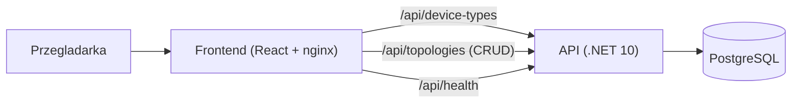
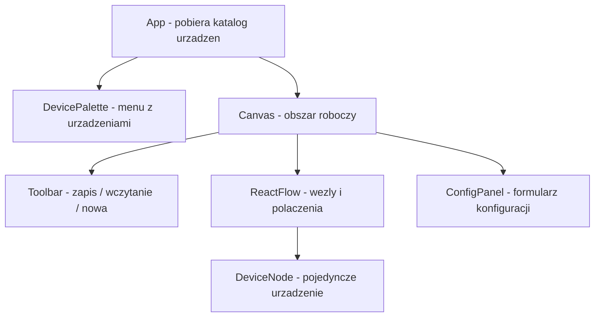

# NetSim - raport projektu

Krotki przewodnik po projekcie: co jest zrobione, jak to dziala i gdzie szukac. Projekt to symulator sieci typu Packet Tracer (przeciaganie urzadzen na pole robocze, laczenie kablem, zapis topologii). Docelowo posluzy do testowania transmisji plikow z kodowaniem cyklicznym (CRC).

## Stan w pigulce

| Obszar | Status | Co dziala |
|--------|--------|-----------|
| Frontend | gotowe (MVP) | paleta urzadzen, drag&drop, laczenie kablem, formularz konfiguracji, zapis/odczyt topologii |
| Backend | gotowe (MVP) | API: katalog urzadzen, health, CRUD topologii |
| Baza danych | gotowe (MVP) | PostgreSQL + tabela `Topologies`, migracja przy starcie |
| Docker | gotowe | `docker compose` uruchamia caly stack (db + api + web) |
| Testy | gotowe | 7 testow xUnit (health, katalog, CRUD topologii) |
| CRC / transmisja plikow | nie rozpoczete | planowane jako kolejny etap |

## Stack technologiczny

- Backend: ASP.NET Core .NET 10 (Minimal API), EF Core + Npgsql
- Frontend: React 19 + TypeScript + Vite + biblioteka React Flow (`@xyflow/react`)
- Baza: PostgreSQL 17
- Orkiestracja lokalna: .NET Aspire 13 (`NetSim.AppHost` + `NetSim.ServiceDefaults`)
- Konteneryzacja: Docker + Docker Compose
- Testy: xUnit + `WebApplicationFactory` (baza in-memory w testach)

## Architektura (jak to sie laczy)



Przeplyw zapisu topologii: uzytkownik uklada urzadzenia na kanwie -> klika "Zapisz" -> frontend serializuje graf (wezly + krawedzie) do JSON -> `POST /api/topologies` -> backend zapisuje JSON w kolumnie `DataJson`. Wczytanie dziala odwrotnie: `GET /api/topologies/{id}` zwraca JSON, ktory frontend odtwarza na kanwie.

## Jak uruchomic

### Aspire (zalecane lokalnie)

Wymaga .NET SDK 10+, Dockera (dla PostgreSQL) i Node.js (frontend Vite).

```bash
dotnet run --project backend/src/NetSim.AppHost
```

Dashboard Aspire otworzy się w przeglądarce. AppHost uruchamia PostgreSQL, API i frontend Vite, wstrzykuje connection string oraz `VITE_API_URL`.

### Docker Compose

```bash
docker compose up -d --build
```

- Frontend: http://localhost:5173
- API: http://localhost:5080
- Dokumentacja API (Scalar/OpenAPI, tryb dev): http://localhost:5080/scalar/v1

Zatrzymanie: `docker compose down`.

Testy backendu:

```bash
dotnet test backend/NetSim.sln -c Release
```

Alternatywnie w kontenerze SDK:

```bash
docker run --rm -v "${PWD}/backend:/src" -w /src mcr.microsoft.com/dotnet/sdk:10.0 dotnet test NetSim.sln -c Release
```

---

## Backend

Lokalizacja: [backend/](../backend/). Punkt wejscia i wszystkie endpointy sa w jednym pliku Minimal API: [Program.cs](../backend/src/NetSim.Api/Program.cs).

### Endpointy API

| Metoda | Sciezka | Opis |
|--------|---------|------|
| GET | `/api/health` | status aplikacji + sprawdzenie polaczenia z baza |
| GET | `/api/device-types` | katalog typow urzadzen do palety (PC, Server, Switch, Router) |
| GET | `/api/topologies` | lista zapisanych topologii (id, nazwa, data) |
| GET | `/api/topologies/{id}` | pelna topologia (graf jako JSON) |
| POST | `/api/topologies` | zapis nowej topologii |
| PUT | `/api/topologies/{id}` | aktualizacja istniejacej |
| DELETE | `/api/topologies/{id}` | usuniecie |

### Kluczowe pliki

- [Program.cs](../backend/src/NetSim.Api/Program.cs) - konfiguracja aplikacji (baza, CORS, OpenAPI), migracje przy starcie, definicje endpointow.
- [Models/DeviceTypeDto.cs](../backend/src/NetSim.Api/Models/DeviceTypeDto.cs) - statyczny katalog urzadzen (`DeviceCatalog`).
- [Models/Topology.cs](../backend/src/NetSim.Api/Models/Topology.cs) - encja bazodanowa topologii.
- [Models/TopologyDtos.cs](../backend/src/NetSim.Api/Models/TopologyDtos.cs) - obiekty transferowe (request/response) dla API.
- [Data/AppDbContext.cs](../backend/src/NetSim.Api/Data/AppDbContext.cs) - kontekst EF Core (mapowanie encji na tabele).

### Pojecia (zeby sie polapac)

- Minimal API - sposob definiowania endpointow bezposrednio w `Program.cs` (bez kontrolerow), np. `app.MapGet(...)`.
- DTO (Data Transfer Object) - prosty obiekt opisujacy dane wymieniane z frontendem, oddzielony od encji bazodanowej.
- CORS - pozwolenie dla przegladarki, by frontend (port 5173) mogl wolac API (port 5080).

---

## Baza danych

- Silnik: PostgreSQL 17 (kontener `db` w [docker-compose.yml](../docker-compose.yml)).
- Dostep z backendu przez EF Core (ORM - mapuje klasy C# na tabele) i sterownik Npgsql.
- Connection string przekazywany zmienna srodowiskowa `ConnectionStrings__Default`.

### Tabela `Topologies`

| Kolumna | Typ | Opis |
|---------|-----|------|
| Id | uuid | klucz glowny (generowany w aplikacji) |
| Name | varchar(200) | nazwa topologii |
| DataJson | text | caly graf (wezly + krawedzie) jako JSON |
| CreatedAt | timestamptz | data utworzenia |

### Migracje

- Schemat tworzy migracja [20261025000000_InitialCreate.cs](../backend/src/NetSim.Api/Migrations/20261025000000_InitialCreate.cs).
- Migracje stosuja sie automatycznie przy starcie API (`MigrateAsync` w [Program.cs](../backend/src/NetSim.Api/Program.cs)).
- Uwaga: przy kolejnych zmianach modelu generuj migracje przez `dotnet ef migrations add` (w kontenerze SDK), zamiast pisac je recznie - recznej migracji latwo zapomniec atrybutu `[Migration(...)]`, co powoduje, ze tabela sie nie tworzy.

### Co to jest migracja?

Migracja to "przepis" na zmiane struktury bazy (utworzenie/zmiana tabel). Dzieki migracjom baza jest odtwarzalna i wersjonowana razem z kodem.

---

## Frontend

Lokalizacja: [frontend/](../frontend/). Aplikacja React budowana przez Vite, uruchamiana w przegladarce.

### Jak zbudowany jest ekran



### Kluczowe pliki

- [src/App.tsx](../frontend/src/App.tsx) - szkielet strony, pobiera typy urzadzen z API.
- [src/components/DevicePalette.tsx](../frontend/src/components/DevicePalette.tsx) - lewa lista urzadzen; elementy sa przeciagalne (drag&drop).
- [src/components/Canvas.tsx](../frontend/src/components/Canvas.tsx) - serce frontendu: upuszczanie urzadzen, laczenie kablem, zaznaczanie, zapis/odczyt topologii, usuwanie.
- [src/components/DeviceNode.tsx](../frontend/src/components/DeviceNode.tsx) - wyglad pojedynczego urzadzenia na kanwie (ikona, nazwa, punkty podlaczenia kabla).
- [src/components/ConfigPanel.tsx](../frontend/src/components/ConfigPanel.tsx) - prawy formularz: nazwa, hostname, adres IP, opis; usuwanie urzadzenia.
- [src/components/Toolbar.tsx](../frontend/src/components/Toolbar.tsx) - gorny pasek: nazwa topologii, zapis, lista do wczytania, "Nowa".
- [src/api.ts](../frontend/src/api.ts) - funkcje wolajace backend (fetch).
- [src/types.ts](../frontend/src/types.ts) - definicje typow (TypeScript).
- [src/index.css](../frontend/src/index.css) - style calej aplikacji.

### Funkcje dla uzytkownika

- Przeciagnij urzadzenie z lewej palety na pole robocze - powstaje wezel.
- Pociagnij od krawedzi jednego urzadzenia do drugiego - powstaje kabel (polaczenie).
- Kliknij urzadzenie - po prawej otwiera sie formularz konfiguracji (nazwa, hostname, IP, opis).
- Klawisz Delete - usuwa zaznaczony wezel lub kabel.
- Pasek gorny - nadaj nazwe i zapisz topologie, wczytaj zapisana lub zacznij nowa.

### Pojecia (zeby sie polapac)

- Komponent - fragment interfejsu (np. przycisk, panel) opisany w jednym pliku `.tsx`.
- Stan (state) - dane pamietane przez komponent (np. lista urzadzen na kanwie); zmiana stanu odswieza widok.
- React Flow - gotowa biblioteka do rysowania grafow: wezly (nodes) i polaczenia (edges) z obsluga myszy.
- Graf topologii - to co zapisujemy: lista wezlow (urzadzen) i krawedzi (kabli).

---

## Sprint 2 — plan wykonania

**Cel sprintu:** miec dzialajaca biblioteke CRC z testami oraz pierwszy, uproszczony przeplyw "wyslij plik z PC do Servera" z weryfikacja CRC (OK / blad), bez pelnej wizualizacji i retransmisji.

**Poza zakresem tego sprintu:** porty/interfejsy urzadzen, walidacja kabli, retransmisja, celowe uszkadzanie blokow w UI, serwer plikow z dyskiem.

### Kryterium sukcesu (Definition of Done)

- Osobny projekt biblioteki CRC w solucji .NET, z testami xUnit (co najmniej: poprawne dane przechodza, uszkodzone dane sa wykrywane).
- Endpoint API: "przeprowadz transmisje" (zrodlo, cel, zawartosc pliku / tekst) zwraca wynik per blok: `ok` albo `crc_error`.
- Na froncie: wybór dwoch urzadzen z topologii + przycisk "Wyslij" + podglad wyniku (lista blokow ze statusem).
- Istniejace testy MVP nadal przechodza; nowe testy pokrywaja CRC i endpoint transmisji.
- `docker compose up -d --build` nadal uruchamia caly stack.

### Zadania (kolejnosc wykonania)

#### 1. Biblioteka CRC (backend)

- [ ] Dodaj projekt klasowy w solucji, np. `NetSim.Crc` (obok `NetSim.Api`).
- [ ] Zaimplementuj CRC (np. CRC-16 lub CRC-32): `Compute(byte[] data) -> checksum`, `Append(data)`, `Verify(frame)`.
- [ ] Podzial danych na bloki o stalej wielkosci (np. 64 B) + checksum na blok.
- [ ] Napisz testy xUnit: znane wektory testowe, dane OK, bit flip w bloku -> `Verify` zwraca false.
- [ ] Podlacz biblioteke do `NetSim.Api` (referencja projektu).

#### 2. API transmisji (backend)

- [ ] Model requestu: id topologii (opcjonalnie), id urzadzenia zrodlowego i docelowego, nazwa pliku, zawartosc (tekst lub base64).
- [ ] Endpoint np. `POST /api/transmission/simulate`:
  - walidacja: oba urzadzenia istnieja w topologii / sa typu PC→Server,
  - podzial na bloki + CRC,
  - opcjonalny parametr `corruptBlockIndex` (do testow wykrywania bledu bez UI),
  - odpowiedz: lista `{ index, size, crcOk, message }`.
- [ ] Testy API: happy path + wykrycie uszkodzonego bloku.

#### 3. UI transmisji (frontend)

- [ ] W `ConfigPanel` lub osobnym panelu: wybor zrodla i celu (lista wezlow z kanwy), pole tekstowe / upload malej zawartosci, przycisk "Wyslij plik".
- [ ] Wyswietlenie wyniku transmisji (tabela/lista blokow: OK / CRC error).
- [ ] Funkcja w [src/api.ts](../frontend/src/api.ts) wolajaca nowy endpoint.
- [ ] Prosty komunikat gdy nie wybrano dwoch urzadzen albo topologia nie jest zapisana (jesli API tego wymaga).

#### 4. Domkniecie sprintu

- [ ] Uzupelnij ten plik: krotka notatka "co dostarczono w Sprincie 2".
- [ ] Sprawdz testy: `dotnet test` w kontenerze SDK (jak w sekcji "Jak uruchomic").
- [ ] Sprawdz recznie w przegladarce: zbuduj topologie PC–Server, wyslij tekst, zobacz bloki OK; z `corruptBlockIndex` zobacz blad.

### Proponowany podzial czasu (orientacyjnie)

| Blok | Czas | Wynik |
|------|------|--------|
| CRC + testy jednostkowe | ~40% | biblioteka gotowa i sprawdzona |
| API transmisji + testy | ~30% | endpoint dziala |
| UI wyboru i wyniku | ~25% | demo w przegladarce |
| Domkniecie / regresja MVP | ~5% | stack i stare testy OK |

### Backlog na kolejne sprinty (nie rob teraz)

1. Porty/interfejsy urzadzen i walidacja polaczen (ktory port z ktorym).
2. Wizualizacja pakietu na kanwie (animacja po kablu).
3. Tryb bledow w UI: celowe uszkodzenie bloku, odrzucenie, retransmisja.
4. Serwer plikow: zapis na dysk / lista plikow / pobieranie.
5. Panel diagnostyczny (log zdarzen transmisji).
